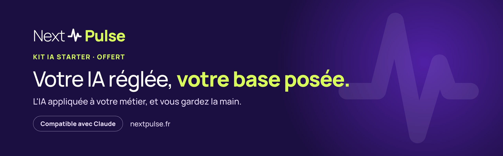

<p align="center">
  <a href="https://www.nextpulse.fr"></a>
</p>

# Les Kits IA NextPulse, pour Claude

Votre IA sait tout faire, sauf votre métier. Les Kits IA de NextPulse la règlent pour votre entreprise, pas à pas, en français. Ils s'adressent aux dirigeants de TPE et de PME, aux indépendants et aux organismes de formation.

## Le Kit IA Starter, offert

Le Kit Starter pose la base de votre IA : les instructions de votre projet et votre mémoire, une façon simple de travailler (un seul projet, une conversation par sujet), votre fiche entreprise, votre charte de marque, votre guide de conception et la constitution de votre IA. Claude vous guide en dix étapes courtes, à votre rythme, et vous gardez la main à chaque étape. Vous repartez avec des documents prêts, rangés dans le projet de votre entreprise, que les Kits suivants sont prévus pour relire.

| Plugin | Ce qu'il fait | Prix |
|---|---|---|
| [`nextpulse-starter`](plugins/nextpulse-starter) | Le Kit IA Starter : votre base IA posée, pas à pas | Offert |

## L'ajouter à Claude

**Dans l'application Claude (offres payantes)** : ouvrez **Plug-ins** dans le menu de gauche, puis **Ajouter > Ajouter une marketplace**, et collez l'adresse de ce dépôt : `https://github.com/PHC-dev-IA/nextpulse-kits`. Ajoutez ensuite le plugin « Kit IA Starter (NextPulse) ».

**Dans Claude Code** (le plugin s'y installe, mais le Kit est conçu pour claude.ai et l'application Claude : les réglages qu'il guide n'existent pas dans Claude Code) :

```
/plugin marketplace add PHC-dev-IA/nextpulse-kits
/plugin install nextpulse-starter@nextpulse-kits
```

Créez ensuite dans Claude un projet au nom de votre entreprise (par exemple « Mon entreprise »), ouvrez-y une nouvelle conversation et écrivez : **Lance le Starter**. Pour reprendre plus tard, une phrase suffit : **On continue**.

**Sans offre Claude payante (Claude gratuit, ChatGPT…)** : le même Kit se copie et se colle, ou se télécharge en PDF. Le pas-à-pas est sur [nextpulse.fr/starter-offert](https://www.nextpulse.fr/starter-offert).

## Qui est derrière

NextPulse aide les petites entreprises à vendre plus et à gagner du temps en appliquant l'IA à leur métier. Pierre-Henri Canonne, son fondateur, est entrepreneur depuis 15 ans et spécialiste du marketing et de la communication. Il utilise lui-même ces méthodes tous les jours.

Site : [nextpulse.fr](https://www.nextpulse.fr) · Contact : [nextpulse.fr/page/contact](https://www.nextpulse.fr/page/contact)

## Licence

Le Kit IA Starter est offert : vous pouvez l'utiliser gratuitement, y compris pour votre activité, et le partager tel quel en citant NextPulse. Ce qu'il produit pour vous vous appartient. Il ne se vend pas et ne se diffuse pas modifié. Le texte complet est dans [plugins/nextpulse-starter/LICENSE](plugins/nextpulse-starter/LICENSE).

© 2026 PHC Consulting (SASU), éditrice de NextPulse.
